<p align="center">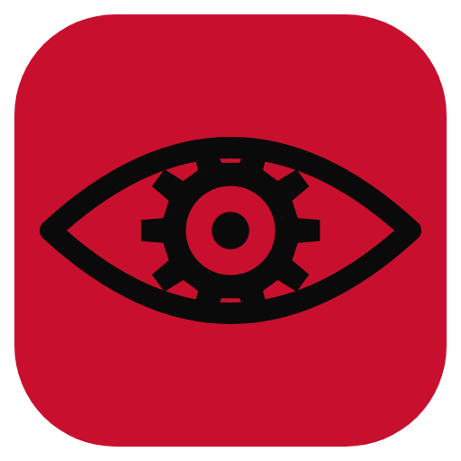</p>

<h1 align="center">Homunculus</h1>

<p align="center">
A frontend for AI roleplay and storytelling, built on <a href="https://github.com/SillyTavern/SillyTavern">SillyTavern</a> through <a href="https://github.com/SillyBunnyTeam/SillyBunny">SillyBunny</a> v1.8.0.<br>
It adds a Group Studio for narrated and co-written stories, a live Scene panel, a Vault for reusable scenarios and NPCs, and a new look.
</p>

<p align="center">
<a href="LICENSE"></a>


</p>

<p align="center">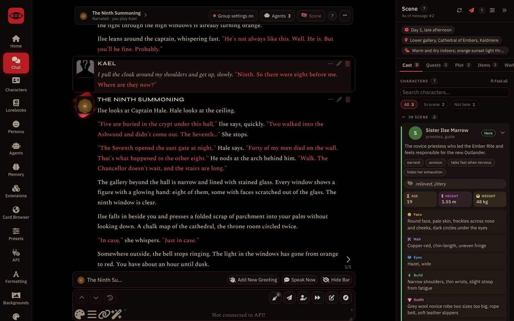</p>

---

## Contents

- [What is Homunculus](#what-is-homunculus)
- [What's new compared to SillyTavern](#whats-new-compared-to-sillytavern)
- [Install and run](#install-and-run)
- [Your first 5 minutes](#your-first-5-minutes)
- [Group Studio](#group-studio)
  - [Quick guide](#quick-guide)
  - [In detail](#group-studio-in-detail)
- [The Scene panel](#the-scene-panel)
- [The group bar](#the-group-bar)
- [Vault](#vault)
- [Agents](#agents)
- [Memory](#memory)
- [Card Browser and Quick Connection](#card-browser-and-quick-connection)
- [Customization](#customization)
- [Updating](#updating)
- [Troubleshooting](#troubleshooting)
- [For developers](#for-developers)
- [Credits and license](#credits-and-license)

---

## What is Homunculus

Homunculus is SillyTavern with extra tools for group stories. Everything SillyTavern and SillyBunny do still works: characters, lorebooks, presets, extensions, the In-Chat Agents and Companions. On top of that, Homunculus adds the screens described below.

Your characters, chats, lorebooks and presets use the same files as SillyTavern. You can copy a SillyTavern `data` folder in and keep using it.

The interface is in English. Most screens have small **?** buttons that explain each option on the spot.

## What's new compared to SillyTavern

| Feature | What it does | Where |
| --- | --- | --- |
| **Group Studio** | Create and set up group chats on one page: cast, narrator, your role, how the story starts, Scene trackers, agents and settings. A guided start asks how you want to play. | Group icon |
| **Narrated mode** | One narrator voices the whole cast and runs the world. The other characters become cast sheets the narrator reads. | Group Studio › Setup |
| **Roles: Player, Co-author, Director** | Play your character, let the AI write your character from your directions, or stay outside the story and direct it. | Group Studio › Setup |
| **Scene panel** | A panel beside the chat that tracks time, place, weather, quests, items, every character's looks and mood, and the plot. Everything in it can be edited. | Scene button on the group bar |
| **Group bar** | A bar above every group chat with the cast, the mode, and buttons for settings, agents and the Scene panel. | Above group chats |
| **Group settings** | A group can bring its own preset, persona, lorebooks and agents. They switch on when you open its chat and switch off when you leave. | Group Studio › Settings |
| **Vault** | Reusable scenarios (setting, NPCs, opening messages, lorebooks) and NPC sheets. | Safe icon |
| **Memory** | Chapters (several summaries per chat, placed where you choose in the prompt) and Recall (finds old messages that match the current moment). | Brain icon |
| **Card Browser** | Search and import character cards from ChubAI, JannyAI, Wyvern, DataCat and Pygmalion inside the app. | Globe icon |
| **Quick Connection** | Switch connection profile and model from the message box. | Chain button in the message box |
| **Home** | Recent chats, characters, lorebooks and your persona in one place, with a Continue button. | House icon |
| **Customize** | Visual profiles (Classic, Arcane Lantern, Blood & Ink), two layouts, and effects you can switch on one by one. | Palette icon |
| **Homunculus presets** | Four ready-made Chat Completion presets: Roleplay, Game Master, Co-author and Director. | Presets |
| **Hob** | A built-in guide character that answers questions about the app. | Characters |
| **The Ninth Summoning** | A short isekai adventure, ready to play, that uses the Group Studio and the Scene panel. | Characters |

## Install and run

### Windows

1. Install [Git](https://git-scm.com/downloads) if you don't have it.
2. Open a terminal in the folder where you want the app and run:
   ```
   git clone https://github.com/VasahTS/Homunculus.git
   ```
3. Open the `Homunculus` folder and double-click **`Start.bat`**.
   The first start installs what it needs (Bun and the app's packages), so it takes a few minutes. Later starts are fast.
4. Your browser opens at **http://127.0.0.1:4444**. If it doesn't, open that address yourself.

`Start.bat` also checks this repository for updates every time you open it.

You can also use **Code › Download ZIP** on GitHub instead of `git clone`. That version works the same but does not update itself.

### macOS and Linux

```bash
git clone https://github.com/VasahTS/Homunculus.git
cd Homunculus
./start.sh          # Linux
./Start.command     # macOS (or double-click it in Finder)
```

You need [Bun](https://bun.sh) or [Node.js](https://nodejs.org) 20 or newer. The launcher picks one and installs the packages on the first run.

### Already using SillyTavern or SillyBunny?

Close the app, then copy your old `data` folder into the Homunculus folder (replace the empty one). Characters, chats, lorebooks, presets and personas carry over.

## Your first 5 minutes

1. **Connect a model.** Open **API** (plug icon), choose a Chat Completion source (OpenRouter, OpenAI, Claude, Google…), paste your API key and press **Connect**. Save it as a **Connection Profile** so you can switch back to it later. Until a model is connected, the message box says *Not connected to API!* and nobody replies.
2. **Say hi to Hob.** Open **Characters** and click **Hob**. Hob is the eye in the flask on the logo, and it knows where every button in the app is. Ask it anything, in any language: *"how do I make a group where one character narrates?"*
3. **Play the demo.** Follow the steps in [Try the demo adventure](#try-the-demo-adventure).

<p align="center">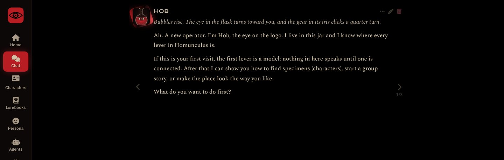</p>

---

## Group Studio

The Group Studio is where group chats are made and set up. Open it with the **group icon** (three people), in the top bar or at the bottom of the sidebar.

### Quick guide

#### Try the demo adventure

*The Ninth Summoning* comes with the app. You wake up in a fantasy kingdom as the ninth person ever summoned from Earth, and a narrator runs the whole world around you.

1. Open **Group Studio** and press **New group**.
2. Pick **Narrated adventure** and press **Continue**.
3. Under **Narrator**, choose **Use one of my characters** and pick **The Ninth Summoning**.
4. Press **Create group and open chat** at the bottom.
5. Write what you do. After each reply, the **Scene** panel fills in the time, the place, your quests, your items and every character you meet.

Optional: in the **Scene** tab of the Group Studio, switch on **Scene: Plot** to also track story threads, what each character wants, and secrets.

#### Make your own group

<p align="center">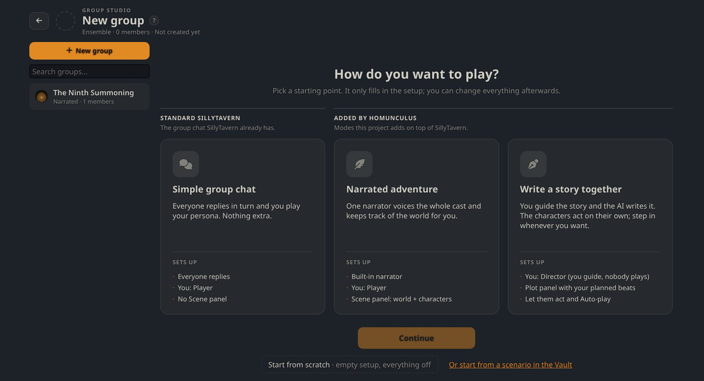</p>

1. **Group Studio › New group.**
2. **Choose how you want to play:**

   | Choice | You get | Good for |
   | --- | --- | --- |
   | **Simple group chat** | The standard SillyTavern group: everyone replies in turn, you play your persona. | Chatting with several characters. |
   | **Narrated adventure** | One narrator voices everyone and keeps track of the world. Scene panel on. | RPG-style adventures, a game master. |
   | **Write a story together** | You are the Director: nobody plays a character, the characters act on their own. Plot panel and auto-play on. | Watching a story unfold, co-writing. |

   You can also **Start from scratch** (everything off) or **start from a scenario in the Vault**.
3. **Add characters** in the **Cast** tab. In Narrated mode this is optional: the narrator can invent characters as it goes.
4. Check the **Ready to play** strip at the bottom. It lists what is done and what is missing. Click an item to jump to it.
5. Press **Create group and open chat**.

The first choice only fills in the setup. Everything stays editable afterwards.

<a id="group-studio-in-detail"></a>
### In detail

<p align="center">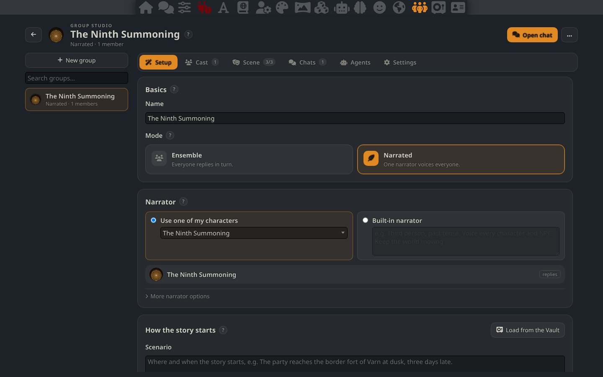</p>

The Studio has a list of your groups on the left and six tabs on the right.

<details>
<summary><b>Setup</b>: name, mode, narrator, opening, your role, story style</summary>

#### Mode

- **Ensemble**: every member replies in turn, like a normal SillyTavern group.
- **Narrated**: only the narrator replies. It describes the world and speaks for every character. The other members stop replying on their own and become **cast sheets** the narrator reads.

#### Narrator (Narrated mode)

- **Use one of my characters**: any card can be the narrator, for example *The Ninth Summoning*.
- **Built-in narrator**: Homunculus makes a narrator for the group. Describe its style in one line (*"Third person, past tense. Voice every character and NPC."*).
- **More narrator options** holds the *turn instruction*: the line the AI gets right before it writes. Leave it empty to use the default.

#### How the story starts

- **Scenario**: where and when the story starts and what is going on. The AI reads it before every reply.
- **Opening message**: the first message of every new chat. Press **+** to add more; they become swipes you choose with the arrows. Empty: the characters' own greetings are used.
- **Load from the Vault** / **Save to the Vault** fills or saves both, with the scenario's lorebooks.

A chat that already started keeps its own opening. Start a new chat to use a changed one.

#### Your role in the story

| Role | Who is {{user}} | What your messages are |
| --- | --- | --- |
| **Player** | You play your persona. | What your character says and does. |
| **Co-author** | Your persona is in the story, but the AI writes them too, in their own voice. | Directions: *"have them argue about the map"*. |
| **Director** | Nobody. You stay outside the story. You can pick a **main character**. | Directions for anyone, or nothing at all. |

In **Co-author** and **Director**:

- Your messages show as *direction* in the chat.
- The group bar gets **Let them act** (one turn with no direction) and **Auto-play ×3 / ×5 / ×10** (several turns in a row; **Stop** ends it).
- **When I send nothing** chooses what happens on those turns: *the characters act* or *the scene just continues*.
- **Instructions for the AI** shows the role text that is sent, and lets you change it.

#### Story style

Simple choices for **Perspective**, **Tense**, **Reply length** and **Tone**. They are sent as a short *Story style* block before each reply. **Edit options** lets you change the wording, add options, or add your own variables. Each one is also a macro (`{{pov}}`, `{{tense}}`, `{{storyStyle}}` for all of them) if you prefer to place it in your preset yourself.

</details>

<details>
<summary><b>Cast</b>: members, who is in the scene, cast sheets, NPCs from the Vault</summary>

- **Add to the cast**: search your characters and click one to add it.
- Each member can be **In scene** (the whole sheet goes to the AI), **Offscreen** (one line, so the narrator knows they exist) or **Off** (nothing is sent).
- **Sheet**: a clean version of the card, without instructions, scenario or first message, made for the narrator to read. Without a sheet, the card's description and personality are used. The card itself is never changed.
- Arrows change the order, the speech bubble **mutes** a member (they stay but don't reply on their own), **×** removes them.
- **From the Vault**: NPCs saved in the Vault. Click one to add it. If it has no character card yet, you check the card that is made for it, then it joins.
- **Put the cast in the prompt automatically**: on, the sheets go in by themselves; off, they only go where your preset writes `{{cast}}`.

</details>

<details>
<summary><b>Scene</b>: the trackers that fill the Scene panel</summary>

<p align="center">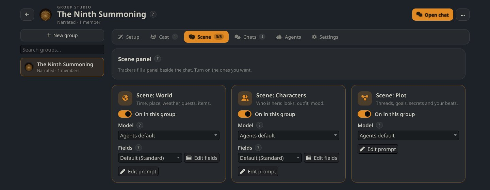</p>

Three **Scene trackers** fill the [Scene panel](#the-scene-panel). They are In-Chat Agents: after each reply, each one makes its own small AI call and saves the result on that message, so swipes and branches keep the right scene.

| Tracker | Tracks |
| --- | --- |
| **Scene: World** | Time, place, weather, quests, items, factions, and any fields you add. |
| **Scene: Characters** | Who is here, their looks (face, hair, eyes, build, outfit, accessories, marks), age, height, weight, traits and mood. |
| **Scene: Plot** | Story threads, what each character wants and will try next, secrets (who knows, who doesn't), and your planned beats. |

For each tracker:

- **On in this group** switches it on for this group only. Your other chats don't change.
- **Model**: pick a cheap, fast connection profile. Trackers don't need your best model.
- **Fields**: a preset of what is tracked. *Standard* fits most stories; there are also *Minimal*, *Superpowers*, *Sci-fi* and *Survival*. **Edit fields** makes your own.
- **Edit prompt** opens the agent editor to change what it tracks or how strict it is.

Trackers respect your lorebooks and cards: fixed facts (a character's height, eye color, species) are copied from them, and new characters follow the lorebook's rules.

</details>

<details>
<summary><b>Chats</b>: every chat of the group</summary>

Every chat of the group, with branches listed under the chat they came from. **Open** switches to a chat; **New chat** starts a fresh one with the group's opening.

</details>

<details>
<summary><b>Agents</b>: agents for this group only</summary>

Choose which In-Chat Agents run in this group's chats:

- **Keep current**: your usual agents.
- **Only these**: only the ones ticked here. Good for a tracker that only makes sense in this story.
- **Add to my usual**: your usual agents, plus the ones ticked here, minus the ones unticked here.

Your own agent lists are not changed.

</details>

<details>
<summary><b>Settings</b>: preset, persona, lorebooks, prompts, who replies</summary>

<p align="center">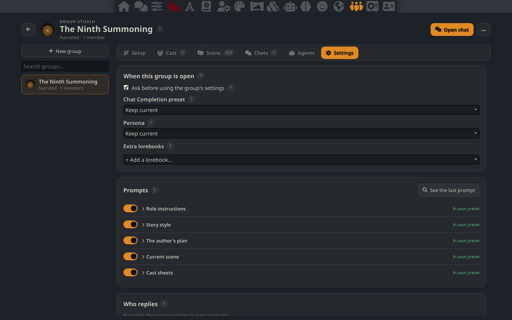</p>

- **Chat Completion preset**, **Persona** and **Extra lorebooks**: the group can bring its own. *Keep current* uses whatever you have selected. Extra lorebooks are only scanned while the group's chat is open.
- **Ask before using the group's settings**: opening the group's chat shows what will change and asks first.
- **Prompts**: the blocks Homunculus sends to the AI (see below), each with an on/off switch and a status.
- **See the last prompt**: shows exactly what was sent on the last reply.
- **Who replies** (Ensemble): *Natural order*, *List order*, *Pooled order* or *Manual*; which cards are sent; whether a character may reply twice in a row.

#### Homunculus presets

Four Chat Completion presets come with the app. Pick one in **Presets**, or set it as the group's preset here.

| Preset | Use it for |
| --- | --- |
| **Homunculus - Roleplay** | One-on-one chats and Simple group chats. You play your persona. |
| **Homunculus - Game Master** | Narrated adventures. The AI runs the world and every NPC. |
| **Homunculus - Co-author** | The Co-author role. Your messages are directions; the AI writes your character too. |
| **Homunculus - Director** | The Director role. Nobody plays a character; you direct from outside. |

All four share the same rules for story, NPCs, dialogue and narration, and differ only in the first block. Each block is a separate entry in the Prompt Manager, so you can switch pieces off without editing text. The Co-author and Director presets contain the role instructions themselves, so the app does not send them twice.

#### Prompt blocks

Homunculus sends these blocks only where your preset has a place for them (a section in the Prompt Manager that holds their macro). The *Default* preset and the four *Homunculus* presets that ship with the app already have all five.

| Block | Macro | What it carries |
| --- | --- | --- |
| Role instructions | `{{homunculusRole}}` | The rules for Co-author or Director. |
| Story style | `{{storyStyle}}` | Perspective, tense, length, tone. |
| The author's plan | `{{authorPlan}}` | Your planned beats from the Plot tab. |
| Current scene | `{{currentScene}}` | A short copy of the Scene panel. |
| Cast sheets | `{{cast}}` | The narrator's sheets of the cast. |

If a block shows **Not sent: no place in your preset**, press **Add them to my preset**, then save the preset.

</details>

---

## The Scene panel

<p align="center">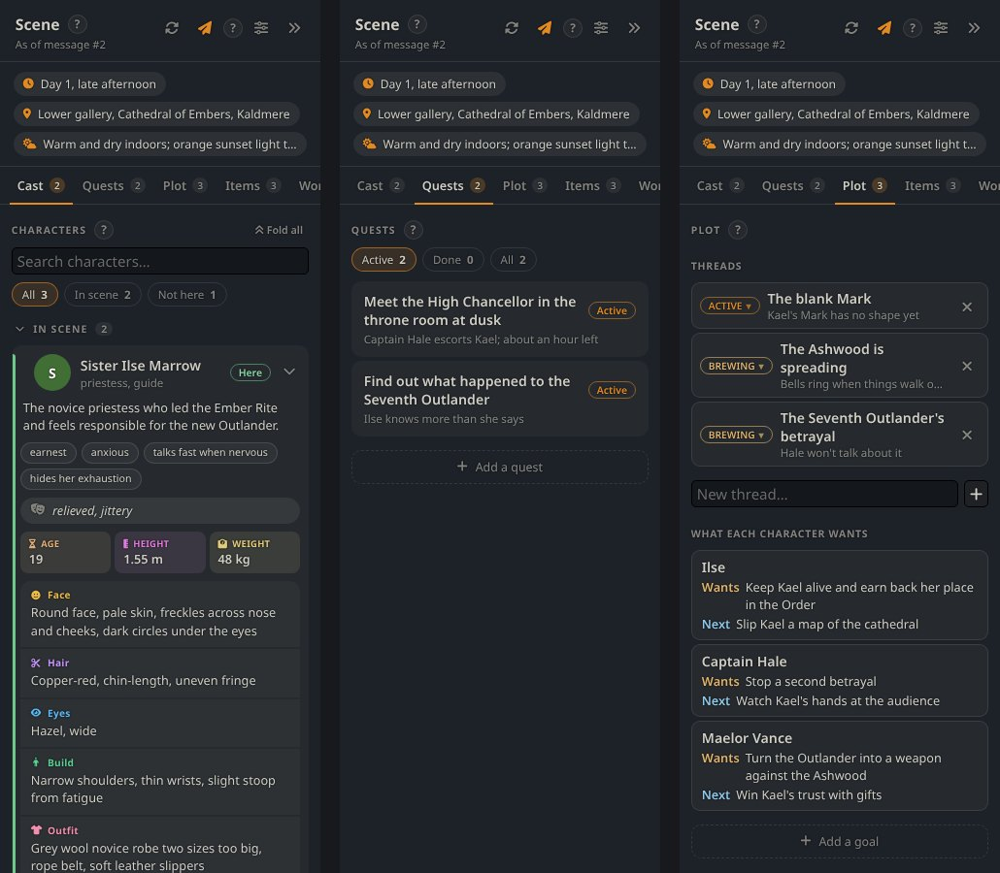</p>

The Scene panel sits on the right of a group chat. Open or close it with the **Scene** button on the group bar.

- **Top**: time, place and weather.
- **Cast**: everyone in the scene and nearby, with their looks, stats, traits and mood. Filter by *In scene* / *Not here*, search, fold cards, and drag cards to reorder or move someone in or out of the scene.
- **Quests**: active, done and failed quests. Shown when you are a Player or Co-author; in Director mode there is no {{user}} to own them, so goals live in Plot.
- **Plot**: threads (*Brewing*, *Active*, *Done*, *Failed*), what each character wants and their next move, secrets, and **your planned beats**. Mark a beat **Steer toward** to pull the story there, or **Not yet** to hold it back.
- **Items** and **World**: inventory, factions and your extra fields.

Everything can be edited. Click any value to change it, click a status to pick another one from a menu, or use **Add a quest / goal / secret / thread**. The next tracker update starts from your edits.

Header buttons: the circular arrows (**Update now**) run the trackers on the last message, the paper plane switches sending the scene to the AI on or off, and the sliders open the tracker setup.

## The group bar

<p align="center">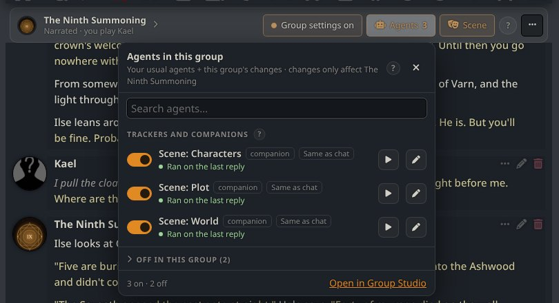</p>

Every group chat has a bar above the messages.

- **Left**: the group's avatars, name, and a line like *Narrated · you play Kael*. Click it to open the Group Studio.
- **Middle** (Co-author and Director): **Let them act**, **Auto-play**, **Stop**.
- **Right**:
  - **Group settings on / Your own settings**: what the group brings (preset, persona, lorebooks, agents), and a switch to use your own settings in this chat. Nothing in the group is lost when you switch it off.
  - **Agents**: switch agents on or off for this group, see what each one did on the last reply, run one now, or open its editor.
  - **Scene**: open or close the Scene panel.
  - **⋯**: Open Group Studio, start a new chat, chats of this group, rename.

## Vault

The **Vault** (safe icon) keeps things you reuse across groups and chats.

- **Scenarios**: a setting, its NPCs, several opening messages, a start time, lorebooks and tags. A scenario can start a new group, be used in the open chat, or be made from one of your characters (**From a character**).
- **NPCs**: full sheets (description, traits, stats, appearance, background, personality, speech, relationships, goals). Save them from the Scene panel or a scenario, let the AI fill the gaps, add them to a scenario, or **Turn into a character** to get a real card.

In the Group Studio, **Setup › How the story starts** loads and saves scenarios, and **Cast › From the Vault** adds NPCs.

## Agents

Agents are small AI helpers that run around each reply. They come from SillyBunny.

- **Before the reply**: they add instructions (for example *Pathfinder*, which finds relevant lorebook entries).
- **After the reply**: they rewrite or check it (for example *Prose Polisher*, which replaces tired wording).
- **Trackers and Companions**: they run beside the chat and keep notes, like the three Scene trackers.

Open **Agents** (robot icon) to switch them on or off, install ready-made ones from **Templates**, or make your own with **New Agent**. Each agent can use its own connection profile and model, so the expensive model only writes the story.

In group chats, agents also see the group's lorebooks and every member's card.

## Memory

**Memory** (brain icon) works per chat. Open a chat first.

- **Chapters**: several summaries, each covering a range of messages. The AI writes them, or you do. Switch each one on or off, and choose where they go in the prompt: before or after the main prompt, inside the chat at a depth, or only where `{{chapters}}` is written. Summarized messages can be hidden from the AI to save room.
- **Recall**: finds old messages that look like the current moment and adds them to the prompt. It runs on SillyTavern's Vector Storage.

## Card Browser and Quick Connection

- **Card Browser** (globe icon): search character cards on **ChubAI**, **JannyAI**, **Wyvern**, **DataCat** and **Pygmalion**. Sort, filter by tag (tick to require a tag, **−** to hide it), toggle NSFW, open a card to read it, and import it with one click.
- **Quick Connection**: the chain button in the message box. Saved connection profiles on the left, that profile's models on the right. Pick one to switch right away; the star pins a model to the top. It lists the profiles you saved in **API**.

---

## Customization

<p align="center">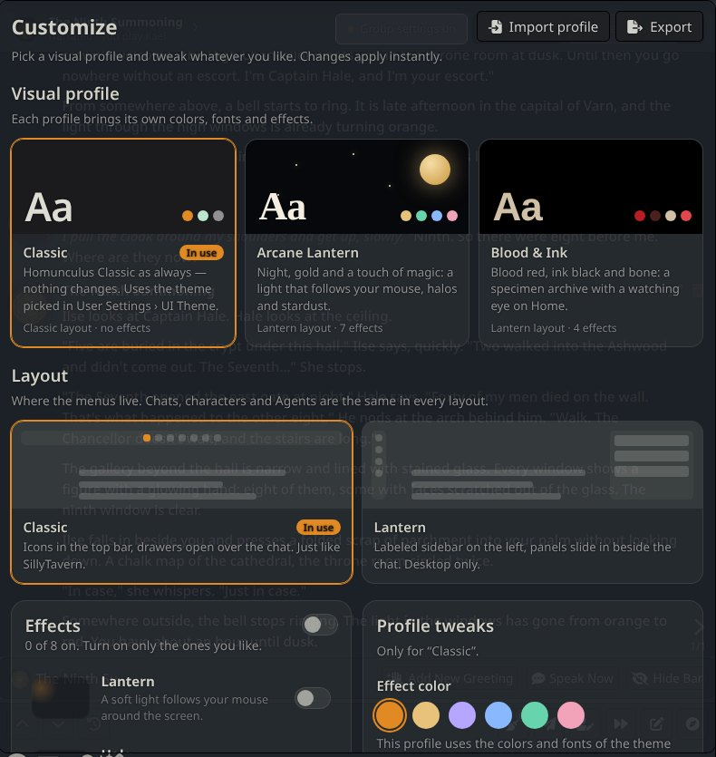</p>

Open **Customize** (palette icon). Changes apply instantly.

### Visual profiles

| Profile | Look | Layout | Effects |
| --- | --- | --- | --- |
| **Classic** | SillyTavern as you know it. Uses the UI Theme from **User Settings**, so your existing SillyTavern themes still work. | Classic | none |
| **Arcane Lantern** | Night blue and gold, serif fonts, a light that follows your mouse, halos and stardust. | Lantern | 7 |
| **Blood & Ink** | Blood red, ink black and bone, a *specimen archive* Home with a watching eye. | Lantern | 4 |

<table>
<tr>
<td>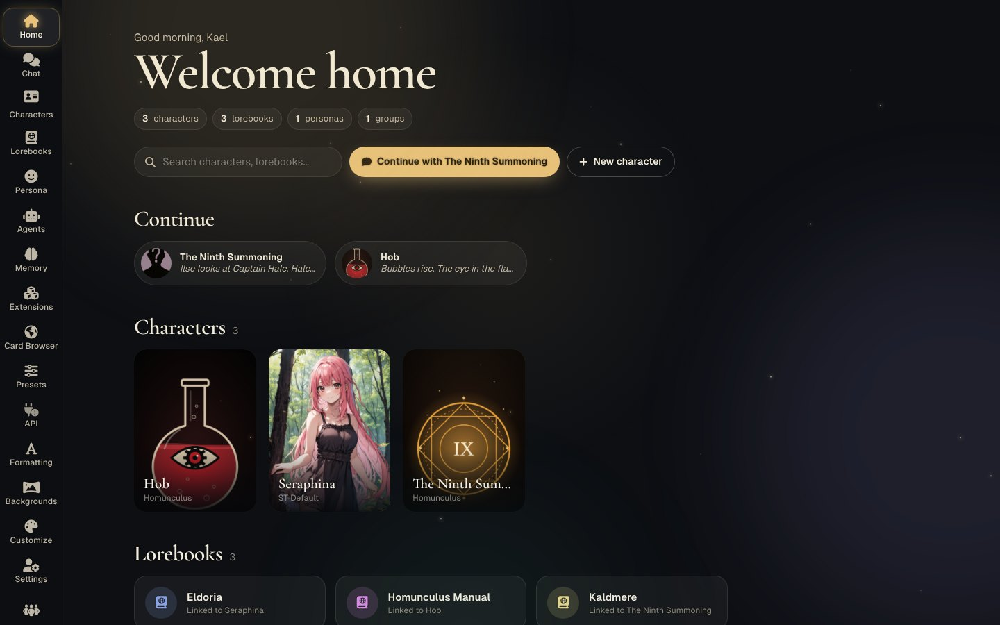</td>
<td>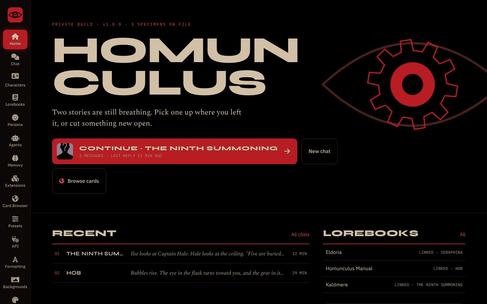</td>
</tr>
<tr>
<td align="center">Arcane Lantern</td>
<td align="center">Blood & Ink</td>
</tr>
</table>

### Layouts

- **Classic**: icons in the top bar; panels open as drawers over the chat. Just like SillyTavern.
- **Lantern**: a labeled sidebar on the left; each item opens its own page beside the chat. Desktop only (windows narrower than 1000 px go back to Classic). In Lantern, the **Presets** page has a lock (*Keep beside chat*) that pins it in a column next to the chat.

Each profile remembers its own layout. You can switch layouts at any time without reloading.

### Effects

Switch each one on or off, with an intensity slider:
**Lantern** (light follows the mouse), **Halo** (ring around the latest avatar), **Sheen** (glint on hover), **Stardust** (drifting specks), **Aurora** (soft color clouds), **Blur-in** (new messages fade in), **Glow** (luminous outlines), **Watching eye** (the logo's gear turns).

**Respect "reduce motion"** stops the effects when your system asks for less animation.

### Profile tweaks

**Effect color** and the other tweaks are saved separately for each profile, so switching profiles never loses your choices.

### Share or make your own

- **Export** saves the current profile to a file; **Import profile** loads one.
- To build a new profile from scratch (colors, fonts, effects, Home style), see [`classic-ui/TEMAS.md`](classic-ui/TEMAS.md) (in Portuguese).
- **Backgrounds** (picture icon) changes the chat background, as in SillyTavern.

---

## Updating

- **With `git clone` on Windows**: `Start.bat` updates the app each time you open it.
- **Manually**: in the Homunculus folder, run `git pull`, then close and reopen the app. Reload the page with **Ctrl+F5** if something looks stale.
- **ZIP download**: download the new ZIP and extract it over the old folder. Your `data` folder is not touched.

New bundled characters and lorebooks (like Hob and *The Ninth Summoning*) are copied to your data on the next start, only if you don't have them yet.

## Troubleshooting

<details>
<summary><b>Nobody replies</b></summary>

No model is connected. The message box says *Not connected to API!* Open **API**, connect, and pick a model.
</details>

<details>
<summary><b>The Scene panel is empty</b></summary>

- No tracker is on for this group: **Group Studio › Scene**, switch on *Scene: World* and *Scene: Characters*.
- They haven't run yet: trackers update after each reply. Press **Update now** in the panel to run them on the last message.
- The tracker's model failed: open **Agents** on the group bar to see what happened on the last reply.
</details>

<details>
<summary><b>The narrator or the roles seem to ignore their instructions</b></summary>

Open **Group Studio › Settings › Prompts**. A block marked *Not sent: no place in your preset* is not reaching the AI. Press **Add them to my preset** and save the preset. **See the last prompt** shows what was actually sent.
</details>

<details>
<summary><b>A setting looks different in one chat only</b></summary>

Check the group bar. *Group settings on* means the group's own preset, persona, lorebooks or agents are in use. Use the switch in that menu to go back to your own settings for this chat.
</details>

<details>
<summary><b>The page looks broken after an update</b></summary>

Reload with **Ctrl+F5**. If the update changed server files, close the app and open it again.
</details>

Still stuck? Ask **Hob**. It knows the app and answers in your language.

---

## For developers

- Homunculus's own files: `public/scripts/classic-*.js`, `public/css/classic*.css`, `public/classic-themes/`, `src/endpoints/classic-card-browser.js` and `classic-ui/`.
- After changing those scripts or styles, run `node classic-ui/apply-classic.mjs`. It wires the files into `public/index.html` and refreshes their cache-busting hashes. Running it again is safe.
- Bundled content (Hob, *The Ninth Summoning*, their lorebooks) lives in `default/content/` and is listed in `default/content/index.json`.
- Lint with `npm run lint`. Tests live in `tests/` (see `CONTRIBUTING.md`).
- Keep compatibility with SillyTavern data, settings, characters, chats, presets and extensions.

## Credits and license

Homunculus stands on the work of **SillyTavern**, **SillyBunny**, **Marinara Engine** and **Aventuras**. See [CREDITS.md](CREDITS.md) for what comes from each.

Licensed under the **GNU Affero General Public License v3.0**, like the projects it builds on. See [LICENSE](LICENSE). If you share it or run it for other people, you must also share its source code and keep the credits.
